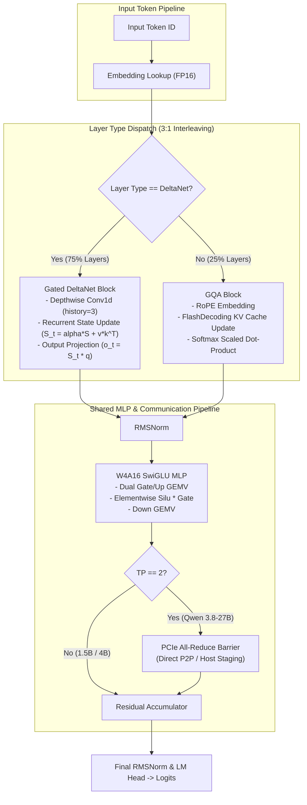

# Multi-Model Test Suite and Documentation Expansion

* **Author:** Areen-09
* **Status:** Approved
* **Date:** 2026-11-09

--------------------------------------------------------------------------------

## Overview

The engine was originally developed as a bare-metal C++20 and CUDA inference runtime specialized for dense `Qwen2.5-1.5B`. Over recent iterations, support was extended to two newer hybrid linear-attention models:
- **Qwen 3.5-4B:** Single-GPU hybrid model interleaving Gated DeltaNet linear attention with standard grouped-query attention (GQA) in a 3:1 ratio.
- **Qwen 3.8-27B:** Dual-GPU hybrid model distributing Gated DeltaNet and GQA across two GPUs using 2-way Tensor Parallelism ($TP=2$) over PCIe.

While the kernel execution paths and weight converters support these newer models, the test infrastructure and public documentation remain anchored to the single-GPU dense 1.5B baseline. This project modernizes the test framework to isolate standalone mathematical kernel validation from weight file downloads, parameterizes dimension handling across scales, and establishes structured documentation for both users and automated development agents.

--------------------------------------------------------------------------------

## The Problem

1. **Brittle File Dependencies in Test Harnesses:**
   `tests/test_kernels.cu` aborts immediately if `models/golden_ref.bin` is missing on disk. In clean CI environments or on developer machines without pre-downloaded multi-gigabyte models, kernel testing cannot run.
2. **Missing Verification for Recurrent and Dynamic Dimensions:**
   The CUDA test suite does not exercise Gated DeltaNet recurrence (`launch_deltanet_decode_sm75`), depthwise Conv1d steps, or non-1536 hidden dimensions (2560 for 4B, 5120 for 27B). Recent dimension parameterization bug fixes in GEMV and SwiGLU kernels currently lack continuous regression verification.
3. **Absence of Recurrent State Parity and Rollback Verification:**
   Gated DeltaNet accumulates state over time ($S_t = \alpha S_{t-1} + v_t k_t^T$). Merely checking for non-crashing execution fails to catch silent numerical drift, decay miscalculation, or state corruption during token rollbacks.
4. **Fragmented Documentation:**
   The repository `README.md` only covers Qwen 2.5-1.5B. Architectural rules (such as 3:1 DeltaNet-to-GQA layering, selective KV cache allocation, and dual-rank PCIe communication) and binary specifications (`.qwenbin` v2 216-byte `LayerDescriptor`) reside exclusively in transient handoff documents and Jupyter notebooks.

--------------------------------------------------------------------------------

## Goals

* **G1: Standalone Mathematical Kernel Suite:** Enable `tests/test_kernels.cu` to execute unit tests using deterministic pseudo-random synthetic tensors without external file dependencies. Synthetic verification focuses on linear attention (DeltaNet, Conv1d) and parameterized GEMV/SwiGLU regressions, while full Split-K FlashDecoding remains verified under `--golden <path>`.
* **G2: Gated DeltaNet & Conv1d Verification:** Implement CPU-vs-CUDA numerical equivalence verification for DeltaNet state recurrence and depthwise Conv1d steps with explicit numerical tolerance limits ($\le 10^{-3}$ absolute error for DeltaNet recurrence, $\le 5 \cdot 10^{-3}$ for Conv1d steps, and $\ge 0.9999$ cosine similarity).
* **G3: Dynamic Dimension Sweeps:** Test kernel launch bounds, shared memory tiling, and memory offsets across hidden sizes $\{256, 1536, 2560, 5120\}$ and intermediate sizes $\{512, 8960, 10240, 27648\}$.
* **G4: Hybrid Rollback Determinism in Python:** Validate in `tests/test_dynamic_engine.py` that hybrid models correctly rollback state via deterministic prefix replay to reproduce bitwise-identical decode outputs.
* **G5: Decoupled Multi-Tier Documentation:**
  * Update root `README.md` with supported models, hardware requirements, and a 2x Tesla T4 Kaggle quickstart recipe.
  * Author `docs/MODELS.md` defining the architectural support matrix, memory allocations, and multi-GPU topologies.
  * Author `docs/SPECIFICATION.md` detailing the `.qwenbin` v2 container format, 216-byte `LayerDescriptor` layout, and runtime invariants.

--------------------------------------------------------------------------------

## Non-Goals

* **NG1: Full Golden Reference Checkpoint Downloads in CI:** No multi-gigabyte model weights will be downloaded or evaluated in automated GitHub Actions CI. Golden reference verification against full models remains an opt-in local flag (`--golden`).
* **NG2: Multimodal Architecture Support:** Out-of-scope for vision-language models (e.g., Qwen 2.5-VL), 3D/2D MRoPE embeddings, or visual patch encoders.
* **NG3: Automated Multi-GPU ($TP=2$) Execution in Synthetic CI:** Automated execution of dual-GPU Tensor Parallel communication barriers is out-of-scope for synthetic CI; verification of inter-GPU P2P all-reduce requires a physical 2-GPU target (e.g., Kaggle 2x Tesla T4). Synthetic unit and integration tests validate single-rank ($TP=1$) execution.
* **NG4: Non-Standard Layer Interleaving:** Model topologies with arbitrary or dynamically reconfigurable DeltaNet-to-GQA stacking ratios outside the standard 3:1 ratio are excluded.
* **NG5: Multi-Gigabyte Synthetic Model Generation in Python:** Generating full 27B-dimension ($H=5120, I=27648$) models in Python pytest suites is excluded to avoid multi-gigabyte disk writes and VRAM quota exhaustion; large dimension testing is restricted to C++ unit tests.

--------------------------------------------------------------------------------

## Open Questions

* None currently open; architectural boundaries and testing constraints were resolved during the ideation and review phases.

--------------------------------------------------------------------------------

## Critical User Journeys (CUJs)

### CUJ 1: Developer Runs Lightweight Unit Tests in Clean Environment
* **Given:** A development or CI environment with an NVIDIA GPU (`sm_75`+) and CUDA toolkit, but zero pre-downloaded model weight files.
* **When:** The developer builds and runs `test_kernels` without arguments.
* **Then:** The test binary executes all synthetic unit tests (RMSNorm, RoPE, W4A16 GEMV, SwiGLU, DeltaNet recurrence, depthwise Conv1d) across standard and dynamic dimensions, reporting pass/fail status and exiting with code 0 without file-read errors.

### CUJ 2: User Deploys Qwen 3.8-27B on Dual-T4 Kaggle Instance
* **Given:** A Kaggle notebook running on 2x Tesla T4 GPUs with `qwen-engine` installed.
* **When:** The user consults `README.md` and initializes `Engine.from_pretrained("areen09/qwen-engine-models-qwenbin", device_ids=[0, 1])` pointing to downloaded rank0 and rank1 `.qwenbin` files.
* **Then:** The model loads weights evenly partitioned across both GPUs (~6.75 GB per GPU), initializes 2-way Tensor Parallelism over PCIe, and generates text deterministically within the 16 GB VRAM quota.

### CUJ 3: Automated Agent Extends Model Transpiler or Kernels
* **Given:** An automated coding agent tasked with updating kernel shared memory bounds or export scripts.
* **When:** The agent inspects `docs/SPECIFICATION.md` and `docs/MODELS.md`.
* **Then:** The agent immediately parses the exact 216-byte binary `LayerDescriptor` layout, 3:1 DeltaNet interleaving rules, and dynamic buffer allocation math without reverse-engineering C++ headers or Python conversion notebooks.

--------------------------------------------------------------------------------

## Technical Plan (Architecture)

### 1. Architectural System Overview

The engine supports three architectural topologies with distinct execution pipelines:
- **Pure Dense GQA:** All layers execute standard grouped-query attention with dynamic KV cache allocation.
- **Hybrid Single-GPU (3:1 Stacking):** Interleaves three Gated DeltaNet linear attention layers with one GQA layer. Gated DeltaNet updates an FP32 recurrent state matrix per attention head ($S_h \in \mathbb{R}^{128 \times 128}$, total layer state $S \in \mathbb{R}^{N_{\text{heads}} \times 128 \times 128}$) and a rolling 3-token Conv1d history buffer without allocating any KV cache.
- **Hybrid Dual-GPU (TP=2):** Partitions Q/K/V projections and MLP column parallel weights across two GPUs (`cuda:0` and `cuda:1`). Down-projection and output projection row-parallel outputs are synchronized via an all-reduce barrier across PCIe.



---

### 2. Standalone CUDA Kernel Test Suite (`tests/test_kernels.cu`)

#### Refactoring Strategy
Currently, `test_kernels.cu` has hardcoded macros (`HIDDEN_SIZE = 1536`, `INTERMEDIATE_SIZE = 8960`) and terminates if `models/golden_ref.bin` is missing. The test binary will be restructured into modular suite functions:

1. **Synthetic Mathematical Suites (Default Execution Mode):**
   - **`run_synthetic_rmsnorm_suite()`**: Allocates deterministic pseudo-random FP16 input vectors on host/device, executes `launch_rmsnorm_fp16` on baseline dimension $H=1536$, and verifies output against a CPU FP64 reference implementation within tolerance $\le 10^{-3}$.
   - **`run_synthetic_rope_suite()`**: Tests rotary position embeddings across sequence positions with head dimension 128 using `launch_qkv_bias_rope_kv_append` wired with zeroed biases, dummy KV cache output buffers, and `d_control->seq_pos = 0`. Verifies against analytic trigonometric reference vectors within tolerance $\le 10^{-3}$.
   - **`run_synthetic_gemv_swiglu_suite()`**: Sweeps dimension pairs dynamically allocated on device:
     - $(H=1536, I=8960)$ [Qwen 2.5-1.5B scale]
     - $(H=2560, I=10240)$ [Qwen 3.5-4B scale]
     - $(H=5120, I=27648)$ [Qwen 3.8-27B scale]
     - $(H=256, I=512)$ [Synthetic minimal scale]
     Validates dynamic shared memory calculations ($H \times \frac{49}{32}$ bytes for Q8_1 activation staging, INT32 block sums, and FP32 group scales) and grid indexing across both FP16 and W4A16 launchers (`launch_gemv_dual_gate_up_swiglu_fp16` and `launch_gemv_dual_gate_up_swiglu_w4a16`). Asserts numerical parity against CPU reference within $\le 5 \cdot 10^{-3}$ and asserts zero NaN/Inf outputs.
   - **`run_synthetic_deltanet_suite()`**:
     - Simulates multi-step sequence recurrence on host CPU using FP64:
       $$\alpha_t = \frac{1}{1 + \exp(\beta_t)}, \quad S_t = \alpha_t S_{t-1} + v_t k_t^T, \quad o_t = S_t q_t$$
     - Initializes zeroed device state buffers and invokes `launch_deltanet_decode_sm75` sequentially ($t = 0 \dots T-1$) on GPU across sequence lengths $T \in \{1, 4, 16, 64\}$ with `batch_size = 1`, `num_heads = 4`, and `head_dim = 128`.
     - Verifies output parity: Maximum absolute error $\le 10^{-3}$, cosine similarity $\ge 0.9999$.
   - **`run_synthetic_conv1d_suite()`**:
     - Simulates rolling 3-element history shift and SiLU activation in `launch_depthwise_conv1d_step` on host CPU; asserts output parity within tolerance $\le 5 \cdot 10^{-3}$.

2. **Golden Reference Mode (`--golden <path>`):**
   - Retains exact golden activation verification against `models/golden_ref.bin` (including Split-K GQA FlashDecoding) when explicitly requested via command-line flags. If omitted, the binary executes all synthetic suites and exits with code 0.

---

### 3. Python Integration & Rollback Suite (`tests/test_dynamic_engine.py`)

The Python test suite operates on `_core.NativeEngine` using synthetic mock models generated on the fly via `tests/test_gguf_converter.py`:

1. **Lightweight Topology Verification:**
   - Retains and polishes `test_qwen35_hybrid_deltanet_execution()` using a 4-layer 3:1 hybrid mock model ($H=256, I=512$, 3 DeltaNet layers, 1 GQA layer).
   - Validates that layer routing, dispatch, and KV cache allocation math operate identically without allocating multi-gigabyte files.
2. **Selective KV Cache Allocation Invariants:**
   - Verifies `engine.get_memory_stats().kv_cache_bytes` matches theoretical bounds:
     $$\text{KV Bytes} = N_{GQA} \times N_{KV\_Heads} \times \text{MaxSeqLen} \times D_{Head} \times 2 \times 2$$
     where the trailing factor $2 \times 2$ accounts for 2 bytes per FP16 element and 2 distinct projection buffers (Key and Value). Asserts that hybrid models allocate zero KV cache bytes for DeltaNet layers, confirming the 75% memory footprint reduction.
3. **Hybrid Rollback and Token Determinism via Prefix Replay:**
   - Ground truth: Hybrid rollback in `src/engine.cu` does not maintain state snapshot buffers; it executes deterministic token prefix replay (`reset_session()` + `prefill(prefix_tokens)`).
   - Advance model autoregressively for $N=6$ decode steps with greedy sampling (`temperature = 0.0`).
   - Call `engine.rollback_to(current_pos - 3)`.
   - Verify `engine.current_seq_pos()` matches rolled-back index.
   - Decode 3 steps and verify produced tokens match original sequence identically, confirming both KV cache pointers and replayed DeltaNet recurrent states restore deterministically.

---

### 4. Three-Tier Documentation Hierarchy

#### Tier 1: Repository Overview & Quickstart (`README.md`)
- High-level project positioning: Bare-metal C++20 / CUDA engine for Qwen 2.5, 3.5, and 3.8.
- Supported Model Table: Parameters, layer configurations, quantization formats, VRAM requirements, and target GPU setups.
- Quickstart guide for `pip install qwen-engine`.
- Kaggle dual-T4 execution recipe with code snippet and dual-rank file specification (`rank0.qwenbin` and `rank1.qwenbin`).

#### Tier 2: Model Architecture & Deployment Guide (`docs/MODELS.md`)
- Comparative architecture table across 1.5B, 4B, and 27B.
- Memory consumption breakdown formulas:
  - Weight footprint (W4A16 group-128 packing layout).
  - Selective KV cache footprint (omitted on DeltaNet layers).
  - Recurrent state memory ($128 \times 128 \times \text{sizeof}(float)$ per head per DeltaNet layer).
  - Dynamic scratch arena sizing based on model intermediate dimension.
- Multi-GPU execution guide: PCIe peer-to-peer (BAR1), Windows host staging fallback, and Linux NCCL all-reduce operations.

#### Tier 3: Technical Engineering Specification (`docs/SPECIFICATION.md`)
- **Binary Container Layout (`.qwenbin` v2):**
  - 64-byte aligned header format, magic `0x5157454E`, version integer `2`.
  - Global metadata (vocab size, hidden size, intermediate size, layer counts).
- **216-Byte `LayerDescriptor` Packing:**
  - Strict struct packing format string `"<2I26Q"` (2 unsigned ints, 26 unsigned 64-bit integers = 216 bytes).
  - Enumeration: `0 = LAYER_GQA`, `1 = LAYER_DELTANET`.
  - Offset mapping for all tensor buffers, quantization scales, and layer biases.
- **Dynamic Memory Arena Layout:**
  - Workspace buffer calculation based on dynamic `intermediate_size` to prevent activation memory overlap:
    - `d_act_q8`: dynamic INT8 quantized activation staging buffer.
    - `d_act_scale`: per-token FP32 dynamic activation scale.
    - `d_act_sum8`: row-sum accumulation buffer for zero-point correction.
  - Shared memory staging footprint: $H \times (1 + \frac{1}{2} + \frac{1}{32}) = H \times \frac{49}{32}$ bytes.

--------------------------------------------------------------------------------

## Alternatives Considered

### Alternative A: Golden Reference Checkpoint Downloads for All Models in CI

* **Pros:** Verifies full end-to-end numerical parity against PyTorch reference activations for real pre-trained weights across 1.5B, 4B, and 27B models.
* **Cons:** Requires downloading over 15 GB of model weights per test invocation; exhausts Kaggle's 20 GB disk quota; completely infeasible on standard GitHub Actions runners which lack free GPU hardware and have strict disk limits.
* **Reason for Rejection:** Downloading multi-gigabyte weights in CI creates severe storage quota failures, lengthens test runtimes from seconds to hours, and cannot execute on GPU-less runners.

### Alternative B: Crash-Only Synthetic Testing (Smoke Testing)

* **Pros:** Minimal implementation complexity; only asserts that CUDA kernel launches return `cudaSuccess` without checking activation values.
* **Cons:** Fails to detect silent numerical corruption, decay parameter ($\alpha$) miscalculations, precision loss, or NaN accumulation in Gated DeltaNet recurrent state matrices.
* **Reason for Rejection:** Pure crash-free checks fail to guarantee correctness in recurrent linear attention, where errors accumulate across sequence steps.

### Alternative C: Monolithic Documentation in `README.md`

* **Pros:** Single file to maintain without managing separate documentation links.
* **Cons:** Intermixes low-level binary packing structs (such as the 216-byte `LayerDescriptor`) and dynamic memory arena offsets with basic pip install and inference tutorials, increasing cognitive friction for developers while burying architectural contracts.
* **Reason for Rejection:** A single monolithic document degrades usability for end users seeking quickstart examples while obscuring technical specifications needed by automated agents.

### Alternative D: Separate Dedicated Test Binaries per Model Family

* **Pros:** Allows each binary to hardcode its specific hidden dimensions and intermediate sizes without parameterization.
* **Cons:** Duplicates test harness boilerplate across `test_kernels_1_5b.cu`, `test_kernels_4b.cu`, and `test_kernels_27b.cu`, resulting in high maintenance overhead and code divergence when kernel interfaces change.
* **Reason for Rejection:** Forking test binaries causes maintenance drift and undermines verification of dynamic kernel parameterization.

### Alternative E: Full-Scale 27B Model Generation in Python Pytest

* **Pros:** Instantiates the true 27B parameter matrix sizes ($H=5120, I=27648$) directly within the Python integration harness.
* **Cons:** Generating 4 layers of SwiGLU MLP weights alone requires over $3.4\text{ GB}$ of GGUF and `.qwenbin` files on disk, consumes $>3\text{ GB}$ VRAM, and exceeds the $500\text{ MB}$ test budget by nearly 7x.
* **Reason for Rejection:** Full-scale dimension allocations in Python integration suites exhaust disk quotas and create severe test latency without testing any unique Python code paths beyond what lightweight mock topologies already verify.

--------------------------------------------------------------------------------

## Risks & Mitigations

| Risk | Impact | Likelihood | Mitigation Strategy |
| :--- | :--- | :--- | :--- |
| **1. CI Environment GPU Absence** | Standard GitHub Actions runners lack CUDA GPUs, causing GPU tests to fail in continuous integration. | High | Partition verification: CI runs CPU-based mock tests, serialization checks, and wheel compilation. Device-dependent CUDA suites execute in self-hosted runners or Kaggle GPU instances. |
| **2. Dynamic Sweep VRAM Exhaustion** | Sweeping large dimensions ($H=5120, I=27648$) could trigger device out-of-memory errors on small GPUs. | Medium | Confine full $(5120, 27648)$ testing strictly to single-kernel C++ unit tests (~150 MB), keeping total device allocation strictly below $500\text{ MB}$. |
| **3. Numerical Tolerance Drift Across Architectures** | Floating-point accumulation variations between Turing (`sm_75`) and newer architectures (`sm_80`-`sm_90`) could cause test flakiness. | Medium | Enforce deterministic PRNG seeds (`std::mt19937(42)`) and architecture-calibrated tolerance thresholds ($\le 10^{-3}$ for DeltaNet, $\le 5 \cdot 10^{-3}$ for Conv1d, $\ge 0.9999$ cosine similarity). |
| **4. Binary Container Memory Safety** | Malformed or corrupt `.qwenbin` v2 headers could trigger buffer overruns during deserialization. | Low | Enforce strict file header bounds checking, magic number validation (`0x5157454E`), and alignment assertions before reading layer descriptors. |

--------------------------------------------------------------------------------

## Non-Functional Requirements

### Performance & Latency
* **Test Suite Runtime:** Standalone synthetic unit tests in `tests/test_kernels.cu` must execute in under 5 seconds on a single Tesla T4 GPU.
* **Memory Footprint During Testing:** Synthetic test suites must limit device memory allocation to $< 500\text{ MB}$, ensuring tests run reliably on memory-constrained GPUs without triggering out-of-memory errors.

### Reliability & Determinism
* **Deterministic Pseudo-Random Seeds:** All synthetic tensor generation on host and device must utilize fixed seeds (`std::mt19937` with seed `42`) to guarantee 100% reproducible test outcomes across test runs.
* **Tolerance Stability:** Numerical tolerance thresholds ($\le 10^{-3}$ absolute error for DeltaNet, $\le 5 \cdot 10^{-3}$ for Conv1d, $\ge 0.9999$ cosine similarity) must pass consistently across compiler optimization levels (`-O3`) and target CUDA architectures (`sm_75`, `sm_80`, `sm_86`, `sm_89`, `sm_90`).

### Maintainability & Backward Compatibility
* **Backward Compatibility with Existing Workflows:** Existing invocation patterns for `test_kernels` using `--golden <path>` must continue functioning without modification.
* **Binary Container Stability:** The 216-byte `LayerDescriptor` layout format string (`"<2I26Q"`) must remain unchanged to preserve compatibility with existing published `.qwenbin` v2 artifacts on Hugging Face Hub.

--------------------------------------------------------------------------------

## Additional Resources

* [`docs/agent_handoff_inference_and_deltanet.md`](file:///c:/Users/agraw/OneDrive/Desktop/cuda-projects/docs/agent_handoff_inference_and_deltanet.md): Root cause analysis and resolution for dynamic dimension parameterization and DeltaNet pointer guards.
* [`notebooks/convert_models_to_qwenbin.ipynb`](file:///c:/Users/agraw/OneDrive/Desktop/cuda-projects/notebooks/convert_models_to_qwenbin.ipynb): Transpiler implementation for W4A16 group-128 quantization and dual-rank TP streaming.
* Hugging Face Hub Repository: [`areen09/qwen-engine-models-qwenbin`](https://huggingface.co/areen09/qwen-engine-models-qwenbin).

--------------------------------------------------------------------------------

## Detailed Implementation Plan

The implementation is partitioned into three incremental phases, each culminating in a stable, buildable, and verifiable checkpoint.

### Phase 1: CUDA C++ Kernel Test Suite Refactoring (`tests/test_kernels.cu`)

#### Target File: `tests/test_kernels.cu` (Modify)
* **Scope:** Standalone parameter-free test suite functions and dynamic dimension sweeps.
* **Detailed Logic:**
  * Refactor existing file-dependent verification into `run_golden_reference_suite(const std::string& golden_path, const std::string& fp16_path, const std::string& w4a16_path)`.
  * Implement standalone synthetic test suites:
    * `run_synthetic_rmsnorm_suite()`: Allocates host/device buffers using `std::mt19937(42)`, invokes `launch_rmsnorm_fp16` on dimension $H=1536$, and asserts max absolute error $\le 10^{-3}$ against CPU FP64 reference.
    * `run_synthetic_rope_suite()`: Invokes `launch_qkv_bias_rope_kv_append` with zeroed bias buffers, dummy KV cache output, `d_control->seq_pos = 0`, and `head_dim = 128`. Asserts trigonometric accuracy within $\le 10^{-3}$.
    * `run_synthetic_gemv_swiglu_suite()`: Iterates over dimension pairs:
      1. $(H=1536, I=8960)$ [1.5B scale]
      2. $(H=2560, I=10240)$ [4B scale]
      3. $(H=5120, I=27648)$ [27B scale]
      4. $(H=256, I=512)$ [Synthetic small scale]
      Allocates dynamic shared memory ($H \times \frac{49}{32}$ bytes). Launches both `launch_gemv_dual_gate_up_swiglu_fp16` and `launch_gemv_dual_gate_up_swiglu_w4a16`. Verifies CPU reference parity within $\le 5 \cdot 10^{-3}$ and asserts zero NaN/Inf values.
    * `run_synthetic_deltanet_suite()`: Sweeps sequence lengths $T \in \{1, 4, 16, 64\}$ with `batch_size = 1`, `num_heads = 4`, `head_dim = 128`. Computes CPU FP64 reference recurrence:
      $$\alpha_t = \frac{1}{1 + \exp(\beta_t)}, \quad S_t = \alpha_t S_{t-1} + v_t k_t^T, \quad o_t = S_t q_t$$
      Executes sequential step loop on device ($t = 0 \dots T-1$) invoking `launch_deltanet_decode_sm75`. Asserts max absolute error $\le 10^{-3}$ and cosine similarity $\ge 0.9999$.
    * `run_synthetic_conv1d_suite()`: Allocates channel dimension $C=2560$ with kernel size 4. Simulates rolling 3-element history shift and SiLU activation on CPU; asserts output parity against `launch_depthwise_conv1d_step` within $\le 5 \cdot 10^{-3}$.
  * Update `main(int argc, char** argv)`:
    * Unconditionally execute `run_synthetic_rmsnorm_suite()`, `run_synthetic_rope_suite()`, `run_synthetic_gemv_swiglu_suite()`, `run_synthetic_deltanet_suite()`, and `run_synthetic_conv1d_suite()`.
    * If `--golden <path>` is supplied, execute `run_golden_reference_suite`.
    * Print pass/fail summary and exit with code 0.

#### Phase 1 Checkpoint:
* Build test binary: `cmake --build build --config Release --target test_kernels -j4`
* Execute test binary: `./build/Release/test_kernels.exe` (Windows) or `./build/test_kernels` (Linux).
* **Success Criteria:** All 5 synthetic suites execute and pass with exit code 0 without any model files on disk.

---

### Phase 2: Python Dynamic Integration Suite Refinement (`tests/test_dynamic_engine.py`)

#### Target File: `tests/test_dynamic_engine.py` (Modify)
* **Scope:** Python pytest integration and hybrid rollback verification.
* **Detailed Logic:**
  * Polish `test_qwen35_hybrid_deltanet_execution()`:
    * Uses `test_gguf_converter.create_synthetic_gguf` to construct a 4-layer hybrid mock model ($H=256, I=512$, 3 DeltaNet layers, 1 GQA layer).
    * Converts to `.qwenbin` and loads via `_core.NativeEngine`.
    * Asserts `num_gqa_layers() == 1` and `num_deltanet_layers() == 3`.
    * Asserts `get_memory_stats().kv_cache_bytes == 524288` (confirming exact 75% KV cache reduction).
    * Executes prefill and decode steps.
  * Update `test_hybrid_rollback_determinism()`:
    * Operates on `_core.NativeEngine` with prompt `[1, 10, 100, 1000]`.
    * Executes 6 consecutive decode steps with `temperature = 0.0`. Records generated tokens.
    * Calls `engine.rollback_to(current_pos - 3)`.
    * Verifies `engine.current_seq_pos()` decrements by 3.
    * Executes 3 decode steps and asserts generated tokens are bitwise-identical to the original tokens from steps 4, 5, and 6, validating deterministic prefix replay.

#### Phase 2 Checkpoint:
* Build C-extension: `pip install -e . --no-build-isolation` (or `cmake --build build --config Release --target _core -j4`).
* Run pytest suite: `pytest tests/test_dynamic_engine.py tests/test_gguf_converter.py -v`.
* **Success Criteria:** All dynamic engine tests pass with exit code 0 in $< 5\text{ seconds}$ and $< 50\text{ MB}$ memory footprint.

---

### Phase 3: Documentation Hierarchy Authoring (`README.md`, `docs/MODELS.md`, `docs/SPECIFICATION.md`)

#### Target File 1: `README.md` (Modify)
* Update title and overview to highlight support for Qwen 2.5-1.5B (dense), Qwen 3.5-4B (hybrid single-GPU), and Qwen 3.8-27B (hybrid dual-GPU TP=2).
* Add Supported Models Matrix table: parameters, layer configurations, quantization format (W4A16 group-128), disk footprint, VRAM requirements, and target hardware.
* Add Quickstart guide for `pip install qwen-engine` and Kaggle 2x Tesla T4 dual-GPU initialization snippet (`Engine.from_pretrained(..., device_ids=[0, 1])`).
* Add links to `docs/MODELS.md` and `docs/SPECIFICATION.md`.

#### Target File 2: `docs/MODELS.md` (Create)
* Comprehensive architecture matrix comparing Qwen 2.5-1.5B, Qwen 3.5-4B, and Qwen 3.8-27B.
* Exact memory formulas for weights, selective KV cache savings (75%), DeltaNet FP32 recurrent states, and dynamic scratch arena.
* Multi-GPU deployment guide: 2-way Tensor Parallelism over PCIe, BAR1 peer-to-peer aperture, Windows host staging fallback, and Linux NCCL all-reduce.

#### Target File 3: `docs/SPECIFICATION.md` (Create)
* `.qwenbin` v2 container specification: 64-byte aligned header, magic `0x5157454E`, version integer `2`.
* 216-byte `LayerDescriptor` struct binary layout (`"<2I26Q"`): exact 28-field ordered list.
* Dynamic memory arena layout: activation staging buffer offsets (`d_act_q8`, `d_act_scale`, `d_act_sum8`) and shared memory footprint derivation ($H \times \frac{49}{32}$ bytes).
* Dual-Rank TP=2 tensor partitioning formulas: column-parallel split for Q/K/V and gate/up projections, row-parallel split for output and down projections, and communication barriers.

#### Phase 3 Checkpoint:
* Verify all relative links across `README.md`, `docs/MODELS.md`, and `docs/SPECIFICATION.md`.
* Build CLI benchmark target to verify shared headers: `cmake --build build --config Release --target cli_bench -j4`.
* **Success Criteria:** Clean Markdown rendering, zero broken links, and successful compilation of all targets.

--------------------------------------------------------------------------------

## Verification Plan

### 1. Compilation & Build Commands
* Build CUDA kernel test target:
  ```bash
  cmake --build build --config Release --target test_kernels -j4
  ```
* Build CLI benchmark target (header regression check):
  ```bash
  cmake --build build --config Release --target cli_bench -j4
  ```
* Build Python C-extension:
  ```bash
  pip install -e . --no-build-isolation
  # Alternative: cmake --build build --config Release --target _core -j4
  ```

### 2. Unit & Integration Test Commands
* Execute standalone synthetic kernel unit tests (must pass with exit code 0 without external files):
  ```bash
  ./build/Release/test_kernels.exe
  # On Linux: ./build/test_kernels
  ```
* Execute Python dynamic integration tests:
  ```bash
  pytest tests/test_dynamic_engine.py tests/test_gguf_converter.py -v
  ```

### 3. Documentation Integrity
* Verify all relative links across `README.md`, `docs/MODELS.md`, and `docs/SPECIFICATION.md` resolve correctly.
* Verify Markdown table syntax and formatting.

--------------------------------------------------------------------------------

*Drafted with EGM*
