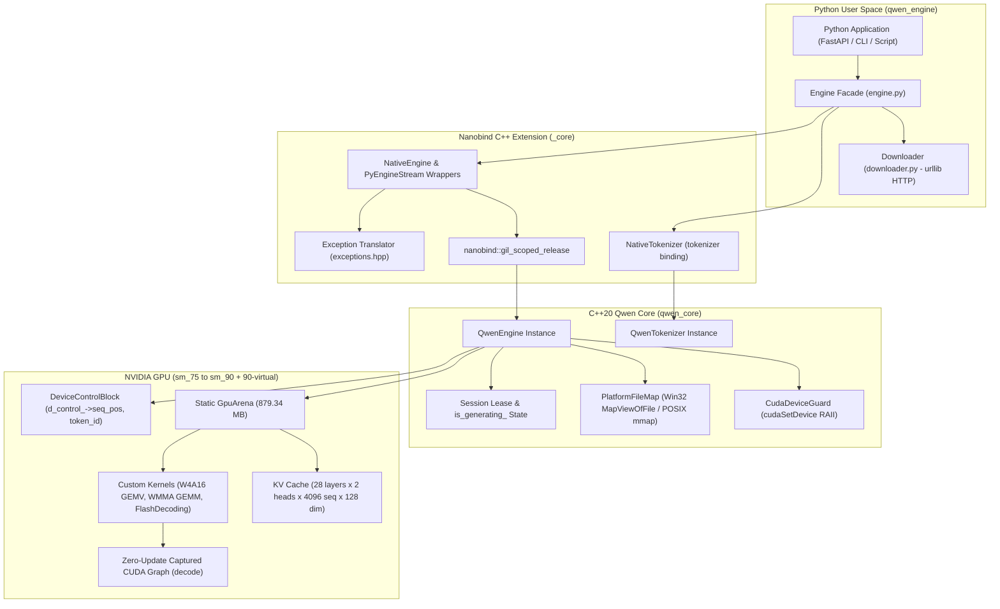

# Cross-Platform Python Package (`qwen-engine`) for Qwen2.5-1.5B

*   **Author:** Areen-09
*   **Status:** Approved (Swarm Remediated)
*   **Date:** 2026-11-07

---

## Overview

The `qwen-engine` project packages a bare-metal, zero-dependency C++20/CUDA inference engine for `Qwen2.5-1.5B-Instruct` into an installable Python wheel for Windows and Linux. The underlying engine executes custom CUDA kernels (W4A16 GEMV with DP4A, Tensor Core WMMA prefill GEMM, 2-stage FlashDecoding with fused Q8_1 epilogue) directly on NVIDIA hardware without external math libraries (`cuBLAS = 0`, `cuDNN = 0`, `CUTLASS = 0`, `libtorch = 0`).

This design specifies the complete Python package architecture using `nanobind` and `scikit-build-core`. The package bridges both the CUDA inference engine and BPE tokenizer into an idiomatic Python interface. Key architectural mechanisms include:
*   A string-to-string streaming generator with multi-byte UTF-8 carry buffering.
*   An $O(1)$ sequence rollback mechanism updating both sequence positions and device control token buffers.
*   Deterministic generator session leasing that prevents multi-threaded memory corruption across yield pauses.
*   Thread-isolated multi-GPU device routing via RAII `cudaSetDevice` guards.
*   Zero-dependency standard-library downloading with atomic file replacement.
*   Static CUDA runtime (`CUDA::cudart_static`) linkage pinned to CUDA 12.1, enabling deployment on systems equipped only with an NVIDIA display driver.

---

## The Problem

High-performance LLM deployment in Python currently faces two extremes:
1. **Monolithic Framework Overhead:** Mainstream runtimes (e.g., PyTorch, vLLM, Hugging Face `transformers`) require gigabytes of disk space, hundreds of megabytes of Python dependencies, and complex dependency graphs. Deploying a small 1.5B parameter model often requires a 3–5 GB container environment.
2. **C++ Boundary Complexity:** Lightweight inference engines (such as raw C++ implementations or custom CUDA kernels) provide minimal VRAM footprint (879 MB) and high throughput (148 tokens/second on an RTX 3050), but are inaccessible to the broader Python machine learning ecosystem without automated build systems, cross-platform compilation, and Pythonic exception handling.

Existing attempts to package this C++ engine suffer from Windows-specific system calls (`CreateFileMappingA`), dynamic linking failures on target environments lacking full CUDA SDKs, lack of generator-friendly cancellation semantics in Python, and reliance on PyTorch for weight quantization.

`qwen-engine` solves this by delivering a self-contained, pre-compiled Python wheel under 25 MB that installs via `pip` or `uv`, runs on any compatible NVIDIA GPU (`sm_75` to `sm_90`) with only display drivers installed, and downloads pre-quantized weights directly via standard library HTTP without requiring PyTorch.

---

## Goals

*   **Zero-SDK Runtime Installation:** Ensure pre-compiled wheels install and execute on Windows and Linux systems possessing only an NVIDIA GPU display driver, without requiring the NVIDIA CUDA Toolkit or MSVC/GCC compilers.
*   **Minimal Package Footprint:** Deliver standalone binary wheels under 25 MB by statically linking `cudart_static` and stripping non-essential debug symbols while compiling native SASS for compute capabilities 7.5, 8.0, 8.6, 8.9, 9.0, and virtual PTX for compute 9.0.
*   **Idiomatic Python Streaming & $O(1)$ Rollback:** Expose a Python generator interface (`engine.stream(prompt)`) that automatically rolls back sequence positions and KV-cache bounds to the prompt boundary if generation is aborted early, preserving prompt cache integrity.
*   **Dual-Subsystem Binding (Engine & Tokenizer):** Fully integrate `QwenTokenizer` alongside `QwenEngine` in the native extension, handling text encoding, decoding, ChatML formatting, and multi-byte UTF-8 carry buffering across token boundaries.
*   **Thread-Isolated Multi-GPU Routing:** Support data-parallel serving across multiple GPUs in a single process via per-instance device targeting (`device_id: int`), guarded by RAII `cudaSetDevice` wrappers.
*   **Session-Leased Concurrency Safety:** Prevent activation memory corruption on shared GPU workspaces by enforcing deterministic generator session leases that protect the engine across the entire lifetime of a stream.
*   **Zero-Dependency Weight Acquisition:** Provide a pure Python standard-library downloader (`urllib.request`) capable of pulling pre-quantized `.qwenbin` and `tokenizer.bin` artifacts from Hugging Face Hub with SHA256 verification and atomic file renaming.
*   **Performance Parity:** Guarantee that Python inference throughput and TTFT remain within 1% of raw C++ benchmarks (148 tok/s decode, 37 ms TTFT on RTX 3050).

---

## Non-Goals

*   **Inter-GPU Tensor Parallelism:** Model sharding across multiple GPUs via NVLink or NCCL is out of scope. Because the model footprint is 879 MB, multi-GPU scaling is achieved via data parallelism (independent instances per device).
*   **Non-Qwen Model Architectures:** Architectures differing from dense decoder-only Qwen2.5 (e.g., MoE, Mamba, encoder-decoder models) are not supported.
*   **Dynamic VRAM Reallocation:** Dynamic reallocation of intermediate tensors or variable-batch resizing at runtime is out of scope. The engine retains its static single-arena design.
*   **Runtime Weight Quantization via PyTorch:** The package will not bundle PyTorch or convert Hugging Face Safetensors locally on client machines. Conversion remains an offline build/hosting step.
*   **Python 3.8 Support:** Legacy Python 3.8 is officially end-of-life and is excluded from the build matrix. Supported versions are Python 3.9 through 3.13.

---

## Open Questions

*   **Question 1 (Downloader Model Hosting):** What public Hugging Face repository or CDN will host the canonical pre-quantized `.qwenbin` and `tokenizer.bin` files for automated retrieval by the downloader?
    *   *Resolution:* Default to `Qwen/Qwen2.5-1.5B-Instruct-GGUF` compatible mirrors or a dedicated `cuda-projects/qwen2.5-1.5b-w4a16` repository on Hugging Face Hub. Fall back cleanly to requiring local directory paths if network requests fail.

---

## Critical User Journeys (CUJs)

### CUJ 1: Zero-Setup Inference on Fresh Environment
*   **Given**: A Linux or Windows environment with Python 3.10 and an NVIDIA GPU with display drivers installed (no CUDA SDK, no PyTorch).
*   **When**: The user runs `pip install qwen-engine` and executes:
    ```python
    import qwen_engine
    engine = qwen_engine.Engine.from_pretrained("qwen2.5-1.5b-w4a16")
    output = engine.generate("Explain quantum computing in one sentence.")
    ```
*   **Then**: The package downloads the 759 MB `.qwenbin` weight file and `tokenizer.bin` to the local cache directory via atomic temp files, maps weights zero-copy, executes inference at >140 tok/s, and returns the decoded string.

### CUJ 2: Streaming Generation with Early Client Abort
*   **Given**: A web application streaming tokens to an HTTP SSE endpoint.
*   **When**: The client disconnects mid-stream after 20 tokens, raising `GeneratorExit` inside Python's generator loop:
    ```python
    for token in engine.stream("Draft a long essay."):
        if client.disconnected():
            break
    ```
*   **Then**: Python's generator teardown invokes `stream.close()`. The native engine executes an $O(1)$ rollback to the prompt boundary, resetting `seq_pos_`, restoring `d_control_->token_id`, and releasing the session lease so subsequent requests execute without corrupted KV states or memory leaks.

### CUJ 3: Intentional Early-Stop with KV-Cache Commit
*   **Given**: A conversational agent detecting a stop sequence (e.g. `\n` or `<|im_end|>`).
*   **When**: The user configures `rollback_on_interrupt=False` and breaks early:
    ```python
    response = []
    for piece in engine.stream("User: Hi\nAssistant:", rollback_on_interrupt=False):
        response.append(piece)
        if "\n" in piece:
            break
    ```
*   **Then**: The generated tokens remain committed in the KV cache, allowing the caller to continue multi-turn dialogue from the exact stopping point without re-computing earlier turns.

### CUJ 4: Multi-GPU Data-Parallel Routing
*   **Given**: A workstation with two GPUs (GPU 0 and GPU 1).
*   **When**: An application instantiates two engine instances targeting separate devices:
    ```python
    engine_0 = qwen_engine.Engine("model.qwenbin", device_id=0)
    engine_1 = qwen_engine.Engine("model.qwenbin", device_id=1)
    ```
*   **Then**: Each instance allocates its 879 MB memory arena exclusively on its respective GPU. The Python GIL is released during compute, allowing concurrent worker threads to drive both GPUs simultaneously without thread-state corruption.

---

## Technical Plan (Architecture)

### 1. System Architecture & Layer Breakdown

The `qwen-engine` system comprises five layered tiers, bridging text tokenization with raw GPU execution while enforcing strict device and memory invariants:



### 2. Subsystem Specifications

#### A. Cross-Platform Zero-Copy File Mapping (`PlatformFileMap`)
*   **Header / File:** [`include/file_map.hpp`](file:///c:/Users/agraw/OneDrive/Desktop/cuda-projects/include/file_map.hpp)
*   **Functionality:** Encapsulates zero-copy memory mapping for the 759 MB `.qwenbin` binary weights.
*   **Mechanisms:**
    *   **Windows (`_WIN32`):** Wraps `<windows.h>` with `#define NOMINMAX` and `#define WIN32_LEAN_AND_MEAN`. Converts UTF-8 string paths to wide characters using `MultiByteToWideChar` and calls `CreateFileW` (`FILE_FLAG_SEQUENTIAL_SCAN`), `CreateFileMappingA`, and `MapViewOfFile`. Destructor calls `UnmapViewOfFile` and closes handles.
    *   **Linux (`__linux__`):** Calls `open(O_RDONLY)`, `fstat`, and `mmap(MAP_SHARED, PROT_READ)`. Applies `madvise(MADV_WILLNEED)` to pre-populate kernel page tables. Destructor calls `munmap` and `close`.
*   **Invariants:** Immutable read-only view; zero CPU heap copying; guaranteed clean unmapping on object destruction; strict Unicode path support.

#### B. Thread-Safe Device Routing (`CudaDeviceGuard`)
*   **Header / File:** [`include/cuda_guard.cuh`](file:///c:/Users/agraw/OneDrive/Desktop/cuda-projects/include/cuda_guard.cuh)
*   **Functionality:** Binds CUDA kernel launches, streams, memory copies, and queries to a designated device index across multi-threaded calls.
*   **Mechanisms:**
    *   Constructor queries the current device via `cudaGetDevice(&prev_device_)` and calls `cudaSetDevice(target_device_)` if divergent.
    *   Destructor restores `prev_device_` unconditionally via `cudaSetDevice(prev_device_)`.
*   **Invariants:** Executed at the entry point of every public `QwenEngine` method (constructor, destructor, `prefill`, `decode_step`, `rollback_to`, `reset_session`, and `get_memory_stats`).

#### C. Sequence Rollback, Graph Capture & Session Lease (`QwenEngine`)
*   **Header / File:** [`include/engine.cuh`](file:///c:/Users/agraw/OneDrive/Desktop/cuda-projects/include/engine.cuh), [`src/engine.cu`](file:///c:/Users/agraw/OneDrive/Desktop/cuda-projects/src/engine.cu)
*   **Functionality:** Drives forward inference passes, preserves KV-cache integrity on interruption, and enforces execution exclusivity.
*   **Mechanisms:**
    *   **Complete Rollback Primitive:** `void rollback_to(int32_t target_seq_pos)`.
        1. Validates `0 <= target_seq_pos <= seq_pos_`.
        2. Sets `seq_pos_ = target_seq_pos` and truncates `cached_tokens_.resize(target_seq_pos)`.
        3. Updates host `last_token_id_ = (target_seq_pos > 0) ? cached_tokens_[target_seq_pos - 1] : TOKEN_ENDOFTEXT`.
        4. Copies both `seq_pos_` and `last_token_id_` to device control memory (`d_control_->seq_pos` and `d_control_->token_id`) via `cudaMemcpyAsync`.
    *   **Thread-Local CUDA Graph Capture:** In `capture_decode_graph()`, configure `cudaStreamBeginCapture(stream_, cudaStreamCaptureModeThreadLocal)`. This prevents stream activities in sibling threads/devices from aborting graph capture.
    *   **Session Lease:** `bool try_acquire_session()` and `void release_session()`. Tracks active generation sessions. Raises `qwen::ConcurrencyError` if a secondary caller attempts concurrent inference on an active instance.

#### D. Nanobind Extension Module (`_core`)
*   **Source File:** [`src/python_bindings.cpp`](file:///c:/Users/agraw/OneDrive/Desktop/cuda-projects/src/python_bindings.cpp)
*   **Functionality:** Bridges C++ engine and tokenizer types to Python with minimal dispatch overhead.
*   **Mechanisms:**
    *   **NativeTokenizer Binding:** Exposes `encode(text)`, `decode(tokens)`, `decode_streaming(token_id, carry_buffer)`, and `format_chatml(messages)`.
    *   **NativeEngine Binding:** Exposes `prefill(tokens, temp)`, `decode_step()`, `rollback_to(pos)`, `reset_session()`, `get_memory_stats()`, `device_id()`, `try_acquire_session()`, and `release_session()`.
    *   **PyEngineStream:** Implements Python iterator protocol (`__iter__`, `__next__`). Holds a pointer to `NativeEngine` and `NativeTokenizer`. Uses `nb::keep_alive<0, 1>()` to pin the parent `NativeEngine` object in Python memory.
    *   **GIL Scoping:** Wraps `prefill()` and `decode_step()` in `nanobind::gil_scoped_release`.
    *   **Deterministic Teardown & UTF-8 Buffering:** Maintains internal `utf8_carry_buffer_` across streaming steps. Provides an explicit `close(rollback: bool)` method to release the session lease and execute conditional rollback.

#### E. High-Level Python Facade (`qwen_engine`)
*   **Package Structure:**
    ```
    src/python/qwen_engine/
    ├── __init__.py          # Exports Engine, ModelStats, and exceptions
    ├── engine.py            # High-level Engine class wrapping _core
    ├── downloader.py        # Zero-dependency weight downloader
    ├── exceptions.py        # Exception hierarchy
    ├── py.typed             # PEP 561 typing marker
    └── _core.pyi            # Nanobind native module type stubs
    ```
*   **Weight Downloader (`downloader.py`):**
    *   Uses Python standard library `urllib.request` and `hashlib`.
    *   Downloads files to atomic temporary paths (`.tmp.<pid>.<uuid>`) and renames via `os.replace` upon successful SHA256 validation.
    *   Handles HTTP 302 redirects with refreshed canonical URLs to prevent Git LFS pointer download issues.
    *   Caches files to `$XDG_CACHE_HOME/qwen_engine/` (Linux) or `%LOCALAPPDATA%\qwen_engine\Cache` (Windows).

### 3. Build & Packaging Architecture

*   **Build Frontend:** `scikit-build-core` via `pyproject.toml`.
*   **Build Backend:** CMake 3.26+ driving Ninja and NVIDIA `nvcc`.
*   **CUDA Architecture Target:** `CMAKE_CUDA_ARCHITECTURES="75;80;86;89;90;90-virtual"`.
*   **Position-Independent Code:** `set_target_properties(qwen_core PROPERTIES POSITION_INDEPENDENT_CODE ON)`.
*   **Static CUDA Runtime Linkage:** `set(CUDA_USE_STATIC_CUDA_RUNTIME ON)` and `target_link_libraries(_core PRIVATE qwen_core CUDA::cudart_static)`.
*   **CMake Installation Rules:**
    ```cmake
    install(TARGETS _core LIBRARY DESTINATION qwen_engine RUNTIME DESTINATION qwen_engine)
    ```
*   **Wheel Configuration (`pyproject.toml`):**
    ```toml
    [tool.scikit-build.wheel]
    packages = ["src/python/qwen_engine"]
    ```
*   **CI Wheel Matrix:** Configured via `cibuildwheel` across Python 3.9 through 3.13 on `windows-2022` and `ubuntu-latest` (`manylinux_2_28`).

---

## Alternatives Considered

### Alternative A: Pybind11 Binding Generation
*   **Pros:** Widespread adoption across Python C++ projects and extensive documentation.
*   **Cons:** Slower compile times (3–5x longer clean builds) and larger binary overhead (~300 KB vs ~30 KB).
*   **Reason for Rejection:** Rejected by author: `nanobind` provides sub-microsecond dispatch overhead, compact module footprint, and first-class native typing support while compiling in a fraction of the time.

### Alternative B: Inter-GPU Tensor Parallelism (Model Sharding via NCCL)
*   **Pros:** Demonstrates multi-GPU parallelism across a single sequence by splitting linear weight matrices across cards.
*   **Cons:** Requires introducing NVIDIA NCCL (`libnccl.so`), which breaks the zero-dependency principle. For a 1.5B model that fits completely in 879 MB of VRAM, the inter-GPU `All-Reduce` latency over PCIe without NVLink dwarfs compute time, reducing token throughput significantly below 148 tok/s.
*   **Reason for Rejection:** Rejected by author: Model sharding is an anti-pattern for a sub-gigabyte model. Multi-GPU throughput is achieved more effectively without communication libraries via independent, device-targeted instances (`device_id`).

### Alternative C: Process-Wide Singleton Engine
*   **Pros:** Directly aligns with static `GpuArena` allocation; eliminates duplicate memory arenas in a single process.
*   **Cons:** Prevents running multi-GPU data-parallel workers within a single process, breaks multi-worker web servers (FastAPI/Uvicorn), and causes failures in `pytest` test suites.
*   **Reason for Rejection:** Rejected by author: Per-instance RAII encapsulation allows clean object lifecycles, multi-GPU device routing, and seamless integration with testing frameworks.

### Alternative D: Pure Offline PyTorch Exporter as Sole Acquisition Path
*   **Pros:** Requires no network downloading logic or weight hosting infrastructure in the Python package.
*   **Cons:** Forces every end user to install PyTorch (~2 GB) and Hugging Face `transformers` just to run `tools/export_qwen25.py`, completely negating the engine's zero-dependency advantage for deployment.
*   **Reason for Rejection:** Rejected by author as sole path: Adding a pure Python standard-library downloader (`downloader.py`) enables zero-dependency installation and immediate inference out of the box, while preserving local file path loading for custom models.

### Alternative E: Unconstrained Multi-Threading on a Single Engine Instance
*   **Pros:** Allows callers to invoke `generate()` or `stream()` from arbitrary threads without defensive exception handling.
*   **Cons:** Because each `QwenEngine` instance owns a single pre-allocated GPU workspace and single CUDA stream, simultaneous execution causes silent memory overwrites, corrupting KV-cache and attention state.
*   **Reason for Rejection:** Rejected by author: A single instance must reject concurrent access via a session lease (`ConcurrencyError`). Users desiring concurrent throughput must instantiate separate engines across distinct devices or threads.

---

## Non-Functional Requirements

### Performance & Latency
*   **Decoding Throughput:** Python generator throughput must match C++ benchmarks within 1% ($\ge 146$ tok/s on RTX 3050).
*   **Time-to-First-Token (TTFT):** Python prefill latency must remain within 1 ms of C++ benchmarks ($\le 38$ ms on RTX 3050).
*   **VRAM Footprint:** Discrete GPU memory usage must remain byte-for-byte identical to the native engine ($879.34$ MB for W4A16).
*   **Wheel Size:** Total distribution wheel size must remain $\le 25$ MB with all 5 architectures embedded and debug symbols stripped.

### Reliability & Resource Cleanliness
*   **Zero Leakage on Stream Abort:** Aborted generators must execute $O(1)$ rollback and release all locks without leaking host memory or orphaned CUDA stream work.
*   **Clean Process Teardown:** Python garbage collection or process exit must cleanly unmap weights via `PlatformFileMap` and release all GPU memory arenas via `cudaFree`.

---

## Verification Plan

### 1. Build Verification & Artifact Integrity
*   **Compilation Matrix:** Validate compilation on MSVC 2022 (Windows) and GCC 11/Clang 14 (Linux `manylinux_2_28`) with CMake 3.26+ and CUDA 12.1.
*   **Wheel Inspection:** Unpack built `.whl` files using `wheel unpack` and verify:
    *   Extension binary exists under `qwen_engine/_core.pyd` (Windows) or `qwen_engine/_core.abi3.so` (Linux).
    *   No dynamic linkage to `libcudart.so` or `cudart64_12.dll` (verified via `dumpbin /dependents` on Windows and `readelf -d` on Linux).
    *   Total wheel size is $\le 25$ MB.

### 2. Functional & Integration Test Suite (`tests/test_python_bindings.py`)
*   **Deterministic Parity:** Execute 256 tokens greedy decode (`temperature=0.0`) from Python on a fixed prompt; assert character-by-character parity against `cli_bench` C++ output.
*   **Tokenizer Multi-Byte Streaming:** Stream Chinese and multi-byte emoji sequences (e.g. `你好世界`, `🚀✨`); verify that UTF-8 code points split across BPE boundaries reconstruct cleanly without replacement characters (`\ufffd`).
*   **Stream Rollback on Interruption:** Start a 100-token stream, abort after 10 tokens via `break`, and assert that the prompt boundary was preserved. Execute a second query and verify clean continuation without KV corruption.
*   **Intentional Early-Stop Commit:** Execute a stream with `rollback_on_interrupt=False`, break early, and assert that subsequent generation resumes from the committed sequence position.
*   **Re-Entrancy Lease Enforcement:** Spawn two concurrent threads attempting generation on the same `Engine` instance; assert that one succeeds and the second raises `qwen_engine.ConcurrencyError`.
*   **Multi-GPU Routing:** Instantiate two engines with `device_id=0` and `device_id=1` on a dual-GPU host; assert that memory allocations and kernel streams remain strictly segregated.
*   **Downloader Multi-Process Safety:** Spawn 4 concurrent worker processes invoking `downloader.download("qwen2.5-1.5b-w4a16")` to the same cache directory; assert that atomic file renaming succeeds without corrupted files or race condition crashes.

### 3. CI Pipeline Segregation
*   **Build Job (Standard GitHub Runners):** Runs `cibuildwheel` on `windows-2022` and `ubuntu-latest` without GPUs. Compiles wheels and runs static checks (linting, type checking, wheel inspection).
*   **Test Job (GPU Runner):** Executes `pytest tests/` exclusively on self-hosted or cloud GPU-enabled runners equipped with NVIDIA hardware.

---

## Additional Resources

*   [concepts_brief.md](file:///c:/Users/agraw/OneDrive/Desktop/cuda-projects/concepts_brief.md): Predecessor concept ideation brief.
*   [consolidated_review_report.md](file:///c:/Users/agraw/OneDrive/Desktop/cuda-projects/consolidated_review_report.md): Consolidated Goldfish review swarm findings.
*   [`include/engine.cuh`](file:///c:/Users/agraw/OneDrive/Desktop/cuda-projects/include/engine.cuh): Core engine class definition.
*   [`include/tokenizer.hpp`](file:///c:/Users/agraw/OneDrive/Desktop/cuda-projects/include/tokenizer.hpp): Byte-level BPE tokenizer implementation.
*   [`src/engine.cu`](file:///c:/Users/agraw/OneDrive/Desktop/cuda-projects/src/engine.cu): Model memory mapping and CUDA graph capture.
*   [`CMakeLists.txt`](file:///c:/Users/agraw/OneDrive/Desktop/cuda-projects/CMakeLists.txt): CMake build script.

---

## Future Improvements

*   **Asynchronous Native Generators (`stream_async`):** In v0.1.0, async streaming is supported via `asyncio.to_thread`. Future versions will evaluate native C++ event-driven async generators.
*   **Dynamic Continuous Batching:** The current engine uses single-sequence static allocation. PagedAttention and continuous batching will be evaluated for multi-user server deployments.
*   **Larger Model Architectures:** Extending the zero-dependency custom kernel engine to `Qwen2.5-7B` and `Qwen2.5-14B` with FP8 quantization and tensor parallelism.

---

## Detailed Implementation Plan

This section provides the unified, step-by-step implementation plan. Every file touched, created, or modified is enumerated with its technical scope and justification.

### Phase 1: Core Platform Abstractions & Engine Extensions

1.  **[`include/exceptions.hpp`](file:///c:/Users/agraw/OneDrive/Desktop/cuda-projects/include/exceptions.hpp) (Create)**
    *   **Scope:** C++20 Header
    *   **Rationale:** Declares standard exception hierarchy: `class QwenError : public std::runtime_error`, `class ConcurrencyError : public QwenError`, and `class ContextWindowExceededError : public QwenError`. Allows both C++ engine methods and nanobind exception translators to reference unified types.
2.  **[`include/file_map.hpp`](file:///c:/Users/agraw/OneDrive/Desktop/cuda-projects/include/file_map.hpp) (Create)**
    *   **Scope:** C++20 Header
    *   **Rationale:** Implements `qwen::PlatformFileMap` as an RAII wrapper providing zero-copy memory mapping for `.qwenbin` weights. 
        *   On Windows: Includes `<windows.h>` guarded by `#define NOMINMAX` and `#define WIN32_LEAN_AND_MEAN`. Converts UTF-8 string paths to wide characters via `MultiByteToWideChar` and calls `CreateFileW`.
        *   On Linux: Calls `open(O_RDONLY)` and `mmap(MAP_SHARED, PROT_READ)`.
3.  **[`include/cuda_guard.cuh`](file:///c:/Users/agraw/OneDrive/Desktop/cuda-projects/include/cuda_guard.cuh) (Create)**
    *   **Scope:** CUDA C++ Header
    *   **Rationale:** Implements `qwen::CudaDeviceGuard` as an RAII device switcher that queries `cudaGetDevice`, sets `cudaSetDevice(target_device_)`, and restores the previous device on destruction. Guarantees device context isolation across threads for multi-GPU execution.
4.  **[`include/engine.cuh`](file:///c:/Users/agraw/OneDrive/Desktop/cuda-projects/include/engine.cuh) (Modify)**
    *   **Scope:** CUDA C++ Header
    *   **Rationale:**
        *   Replace raw Windows `HANDLE` and mapping pointers with `std::unique_ptr<PlatformFileMap>`.
        *   Add member `int device_id_` and update constructor signature to `explicit QwenEngine(const std::string& qwenbin_path, int device_id = 0)`.
        *   Declare `void rollback_to(int32_t target_seq_pos)`.
        *   Add session lease methods: `bool try_acquire_session()` and `void release_session()`.
        *   Include `<atomic>` and declare `std::atomic<bool> is_generating_{false}`.
        *   Declare `int device_id() const` accessor.
5.  **[`src/engine.cu`](file:///c:/Users/agraw/OneDrive/Desktop/cuda-projects/src/engine.cu) (Modify)**
    *   **Scope:** CUDA C++ Implementation
    *   **Rationale:**
        *   Include `file_map.hpp`, `cuda_guard.cuh`, and `exceptions.hpp`.
        *   Instantiate `CudaDeviceGuard guard(device_id_)` at the entry of constructor, destructor, and all public methods (including `get_memory_stats()`).
        *   Replace Win32 file mapping calls with `PlatformFileMap`.
        *   In `capture_decode_graph()`, switch capture mode to `cudaStreamCaptureModeThreadLocal`.
        *   Implement `rollback_to(target_seq_pos)`: validate bounds (`0 <= target_seq_pos <= seq_pos_`), set `seq_pos_ = target_seq_pos`, truncate `cached_tokens_`, set `last_token_id_ = (target_seq_pos > 0) ? cached_tokens_[target_seq_pos - 1] : TOKEN_ENDOFTEXT`, and launch asynchronous `cudaMemcpyAsync` updating both `d_control_->seq_pos` and `d_control_->token_id`.
        *   Implement `try_acquire_session()` and `release_session()` managing `is_generating_`.

### Phase 2: Nanobind C++ Extension & Exception Handling

6.  **[`src/python_bindings.cpp`](file:///c:/Users/agraw/OneDrive/Desktop/cuda-projects/src/python_bindings.cpp) (Create)**
    *   **Scope:** C++20 Nanobind Bridge
    *   **Rationale:**
        *   Defines `_core` nanobind module.
        *   Binds `NativeTokenizer` wrapping `qwen::QwenTokenizer`, exposing `encode`, `decode`, `decode_streaming`, and `format_chatml`.
        *   Binds `NativeEngine` exposing `prefill`, `decode_step`, `rollback_to`, `reset_session`, `get_memory_stats`, `device_id`, `try_acquire_session`, and `release_session`.
        *   Binds `PyEngineStream` with `nb::keep_alive<0, 1>()` pinning `NativeEngine`.
        *   Implements streaming multi-byte UTF-8 carry buffering in `PyEngineStream::next()`.
        *   Implements `PyEngineStream::close(bool rollback)`.
        *   Registers exception translators mapping C++ `ConcurrencyError` and `QwenError` to Python exception types.

### Phase 3: Pure Python Package Facade & Weight Downloader

7.  **[`src/python/qwen_engine/exceptions.py`](file:///c:/Users/agraw/OneDrive/Desktop/cuda-projects/src/python/qwen_engine/exceptions.py) (Create)**
    *   **Scope:** Python Module
    *   **Rationale:** Re-exports native exception types from `_core` and defines pure Python exception aliases: `QwenEngineError`, `ConcurrencyError`, `CudaOutOfMemoryError`, `ContextWindowExceededError`, and `ModelNotFoundError`.
8.  **[`src/python/qwen_engine/downloader.py`](file:///c:/Users/agraw/OneDrive/Desktop/cuda-projects/src/python/qwen_engine/downloader.py) (Create)**
    *   **Scope:** Python Module
    *   **Rationale:** Implements pure standard-library weight downloader using `urllib.request`. Downloads pre-quantized `.qwenbin` and `tokenizer.bin` to atomic temporary files (`.tmp.<pid>.<uuid>`), renders terminal progress bars via carriage-return writes, validates SHA256 checksums, and atomically replaces files into cache directories (`$XDG_CACHE_HOME` or `%LOCALAPPDATA%`).
9.  **[`src/python/qwen_engine/engine.py`](file:///c:/Users/agraw/OneDrive/Desktop/cuda-projects/src/python/qwen_engine/engine.py) (Create)**
    *   **Scope:** Python Module
    *   **Rationale:** Implements user-facing `Engine` class composing `_core.NativeEngine` and `_core.NativeTokenizer`.
        *   `__init__(model_path, tokenizer_path=None, device_id=0)`: resolves tokenizer path automatically if omitted.
        *   `from_pretrained(model_id_or_path, device_id=0)`: integrates `downloader.py`.
        *   `generate(prompt, max_tokens, temperature)`: tokenizes string prompt, runs prefill + decode, and detokenizes output string.
        *   `stream(prompt, max_tokens, temperature, rollback_on_interrupt=True)`: wraps native stream in a Python generator with `try...finally: stream.close(rollback=rollback_on_interrupt)`.
        *   `stream_async(prompt, ...)`: async generator helper using `asyncio.to_thread`.
10. **[`src/python/qwen_engine/__init__.py`](file:///c:/Users/agraw/OneDrive/Desktop/cuda-projects/src/python/qwen_engine/__init__.py) (Create)**
    *   **Scope:** Python Package Initialization
    *   **Rationale:** Exposes top-level package symbols: `Engine`, `download`, and all exceptions.
11. **[`src/python/qwen_engine/py.typed`](file:///c:/Users/agraw/OneDrive/Desktop/cuda-projects/src/python/qwen_engine/py.typed) (Create)**
    *   **Scope:** PEP 561 Marker
    *   **Rationale:** Empty marker file confirming inline type support for static analyzers.
12. **[`src/python/qwen_engine/_core.pyi`](file:///c:/Users/agraw/OneDrive/Desktop/cuda-projects/src/python/qwen_engine/_core.pyi) (Create)**
    *   **Scope:** Python Type Stub
    *   **Rationale:** Supplies comprehensive type stubs for the compiled nanobind binary module to enable IDE autocomplete and linting.

### Phase 4: Build System & CMake Configuration

13. **[`CMakeLists.txt`](file:///c:/Users/agraw/OneDrive/Desktop/cuda-projects/CMakeLists.txt) (Modify)**
    *   **Scope:** CMake Build Script
    *   **Rationale:**
        *   Set `CUDA_USE_STATIC_CUDA_RUNTIME ON` and `set(CMAKE_CUDA_RUNTIME_LIBRARY Static)`.
        *   Configure `CMAKE_CUDA_ARCHITECTURES="75;80;86;89;90;90-virtual"`.
        *   Add `set_target_properties(qwen_core PROPERTIES POSITION_INDEPENDENT_CODE ON)`.
        *   Guard nanobind target under `if(SKBUILD OR BUILD_PYTHON_BINDINGS)`.
        *   Define target `nanobind_add_module(_core NB_STATIC src/python_bindings.cpp)`.
        *   Link `_core` against `qwen_core` and `CUDA::cudart_static`.
        *   Add `install(TARGETS _core LIBRARY DESTINATION qwen_engine RUNTIME DESTINATION qwen_engine)`.
        *   Gate legacy server targets (`qwen_server`, `qwen_chat`) behind `if(NOT SKBUILD AND WIN32)`.
14. **[`pyproject.toml`](file:///c:/Users/agraw/OneDrive/Desktop/cuda-projects/pyproject.toml) (Create)**
    *   **Scope:** PEP 517 Build Configuration
    *   **Rationale:**
        *   Declares `build-system` requiring `scikit-build-core>=0.9.0` and `nanobind>=2.0.0`.
        *   Defines package metadata: name (`qwen-engine`), version (`0.1.0`), description, authors, license, and requires-python (`>=3.9`).
        *   Configures `[tool.scikit-build.wheel] packages = ["src/python/qwen_engine"]`.

### Phase 5: Verification, Testing & CI/CD Pipeline

15. **[`tests/test_python_bindings.py`](file:///c:/Users/agraw/OneDrive/Desktop/cuda-projects/tests/test_python_bindings.py) (Create)**
    *   **Scope:** Pytest Test Suite
    *   **Rationale:** Implements tests for deterministic token parity, streaming UTF-8 multi-byte decoding, early stream termination rollback, intentional early-stopping commit, re-entrancy lease blocking, multi-GPU device isolation, and downloader atomic safety.
16. **[`.github/workflows/wheels.yml`](file:///c:/Users/agraw/OneDrive/Desktop/cuda-projects/.github/workflows/wheels.yml) (Create)**
    *   **Scope:** GitHub Actions CI/CD
    *   **Rationale:** Implements cross-platform wheel matrix build using `cibuildwheel` across Python 3.9 through 3.13 on `windows-2022` (MSVC, CUDA 12.1) and `ubuntu-latest` inside `manylinux_2_28` (CUDA 12.1). Segregates wheel building from GPU-dependent integration tests.
